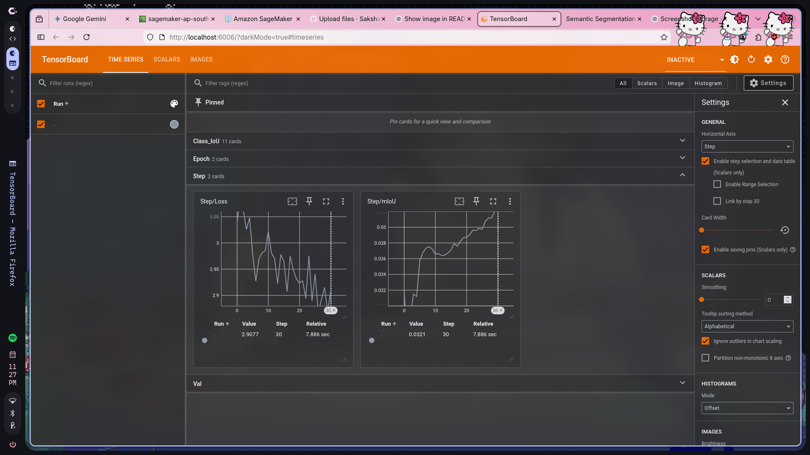
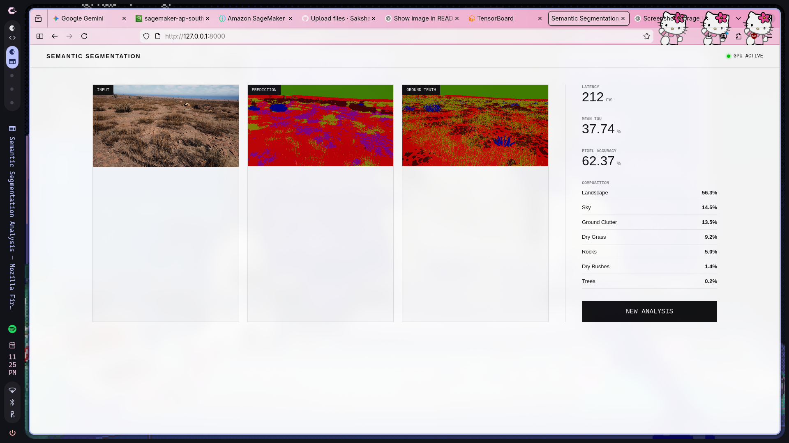

```
  _____   _____  _____  ____  _____  ______ 
 |  __ \ / ____|/ ____|/ __ \|  __ \|  ____|
 | |__) | (___ | |    | |  | | |  | | |__   
 |  ___/ \___ \| |    | |  | | |  | |  __|  
 | |     ____) | |____| |__| | |__| | |____ 
 |_|    |_____/ \_____|\____/|_____/|______| 
```

# DinoTerrainMax: Semantic Segmentation Analysis

**High-Fidelity Terrain Classification System**

[](http://43.204.148.104)

---

## Overview

DinoTerrainMax is an advanced semantic segmentation system for precise terrain classification. Built with DINOv2 and ASPP architecture, it provides real-time pixel-level terrain analysis for 11 distinct environmental classes.

---

## Terrain Classes

| Class ID | Classification | Class ID | Classification | Class ID | Classification |
|----------|----------------|----------|----------------|----------|----------------|
| 0 | Background | 4 | Dry Bushes | 8 | Rocks |
| 1 | Trees | 5 | Ground Clutter | 9 | Landscape |
| 2 | Lush Bushes | 6 | Flowers | 10 | Sky |
| 3 | Dry Grass | 7 | Logs | | |

---

## Project Structure

```
KrackSegmentation/
├── train.py               # Training pipeline
├── test.py                # Evaluation script
├── requirments.txt        # Dependencies
├── data/                  # Dataset (user prepares)
│   ├── train/
│   ├── val/
│   └── test/
├── stats/                 # Model checkpoints & logs
│   ├── best_model.pth
│   ├── logs/
│   └── test_results/
└── server/                # Web application
    ├── app.py
    ├── static/
    └── templates/
```

---

## Quick Start

### Prerequisites
- Python 3.9+
- CUDA GPU (recommended)
- 8GB+ RAM

### Installation

```bash
# Clone repository
git clone https://github.com/Sakshamsetia/KrackSegmentation.git
cd KrackSegmentation

# Install dependencies
pip install -r requirments.txt
```

### Download Pre-trained Model

📥 **[Download best_model.pth from Google Drive](https://drive.google.com/file/d/1tJSukzaZsfavxi9b-HNS7G7vDNrRB8e8/view?usp=sharing)**

```bash
# Create stats directory and place model
mkdir -p stats
mv ~/Downloads/best_model.pth stats/

# Verify (~330MB)
ls -lh stats/best_model.pth
```

> **Note:** Download the pre-trained model to skip training and immediately use testing or web interface.

### Prepare Dataset

```bash
mkdir -p data/{train,val,test}/{Color_Images,Segmentation}
```

Place images in `Color_Images/` and masks in `Segmentation/` for each split.

**Mask Format:** Pixel values `{0, 100, 200, 300, 500, 550, 600, 700, 800, 7100, 10000}` map to class IDs 0-10.

---

## Usage

### 1. Training (Optional)

```bash
python train.py
```

**Configuration:** Batch=4, LR=6e-5, Epochs=10, Resolution=476×266

### 2. Monitor with TensorBoard

```bash
tensorboard --logdir=stats/logs
```

Navigate to `http://localhost:6006`



### 3. Testing

```bash
python test.py
```

Results saved to `stats/test_results/` showing: Original | Ground Truth | Prediction

### 4. Web Interface

```bash
python server/app.py
```

Open `http://127.0.0.1:8000`



**Features:**
- Upload terrain images (JPG/PNG)
- Real-time segmentation
- Optional ground truth comparison
- Metrics: mIoU, Pixel Accuracy, Class Distribution
- Downloadable prediction masks

---

## Model Architecture

```
Input (3×266×476)
    ↓
DINOv2 Encoder (ViT-B/14)
    ↓
ASPP Module (Multi-scale Context)
    ↓
Residual Decoder + Attention Gates
    ↓
Edge Enhancement Pathway
    ↓
Output (11×266×476)
```

**Key Features:**
- **Encoder:** DINOv2 self-supervised learning
- **Context:** Multi-scale ASPP with dilated convolutions
- **Decoder:** Residual blocks with attention gates
- **Edge Path:** Preserves fine geometric details

---

## Performance

| Metric | Value |
|--------|-------|
| Resolution | 476×266 pixels |
| Parameters | ~86M |
| GPU Time | 50-100ms |
| CPU Time | 500-1000ms |
| GPU Memory | ~2GB VRAM |
| Model Size | ~330MB |
| Training | ~2-4 hours (10 epochs) |

---

## Advanced Configuration

Edit `train.py` for custom settings:

**Class Weights:**
```python
CLASS_WEIGHTS = torch.tensor([1.0, 2.0, 10.0, ...])
```

**Augmentation:**
- Random flips/rotations
- Color jittering
- ImageNet normalization

---

## Acknowledgments

Built with:
- DINOv2 (Meta AI)
- DeepLabV3+ Architecture
- PyTorch
- Flask

---

[View Repository](https://github.com/Sakshamsetia/KrackSegmentation)
